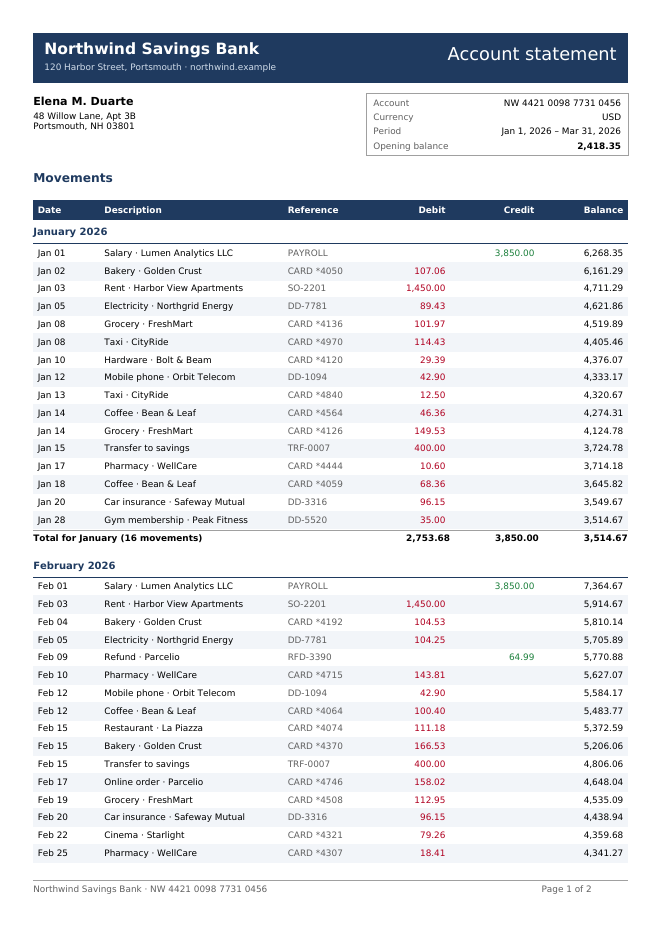

# Bank account statement

An account statement for one quarter: the bank and the account holder, the account, its
currency and period, the opening balance, then every movement month by month with its debit or
credit and the balance after it, a total for each month, and a closing summary. The data is made
up.



```bash
ferroreport render report.jrxml --data data.json --params params.json -o statement.pdf
```

What it shows:

- **Running balance:** a `Sum` variable of the amounts (`$V{Movement}`) added to the
  `OpeningBalance` parameter, printed on every row, at the end of every month and in the summary.
- **Debit and credit columns** from one signed `amount` field, each blank when the other applies
  (`blankWhenNull`).
- **A group per month** (`new java.text.SimpleDateFormat("yyyy-MM").format($F{date})`), with
  totals that reset with the group and a count of its movements.
- Alternate row shading with `printWhenExpression`, styles for amounts and headings, and
  "Page X of Y" in the page footer (`evaluationTime="Report"`).

It renders the same as in JasperReports 7.1.1, pixel for pixel (`tools/compare.py`). The
expressions that format dates with `SimpleDateFormat` use the Java runtime's time zone, not the
report's; `tools/compare.py` runs JasperReports in UTC, so they match.
